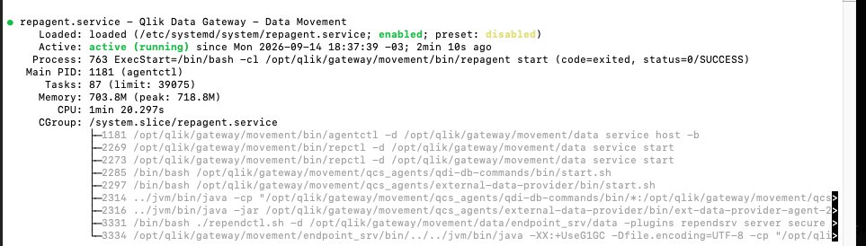
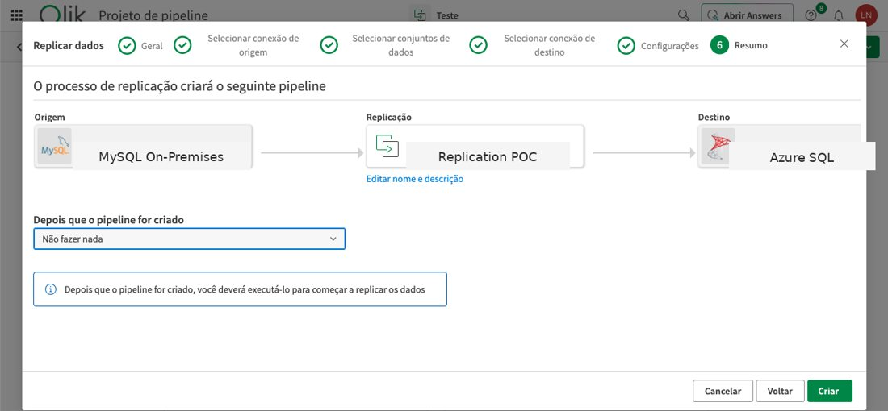
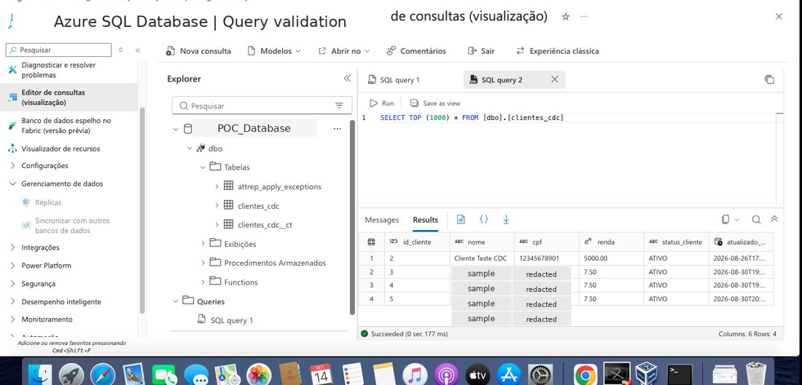

# Prova de Conceito de Integração de Dados com Qlik Talend Cloud


> **Estudo de caso para portfólio baseado em uma prova de conceito real e em andamento de BI e integração de dados.** Nomes específicos de clientes, credenciais, endereços, identificadores de infraestrutura e dados de negócio foram intencionalmente omitidos ou anonimizados.

## Visão geral

Este projeto documenta uma **prova de conceito (POC) com Qlik Talend Cloud (QTC)**, cujo objetivo é movimentar dados operacionais de um **banco de dados MySQL em ambiente local (on-premises)** para plataformas de destino e, gradualmente, validar outros recursos de integração de dados da Qlik.

O primeiro fluxo validado movimentou dados do **MySQL local** para o **Azure SQL Database**, utilizando o Qlik Talend Cloud Data Movement. O desenho da replicação também incluiu **CDC (Change Data Capture, ou Captura de Dados Alterados)**, permitindo propagar incrementalmente as alterações realizadas na origem após a carga inicial, sem exigir uma recarga completa a cada mudança.

Atualmente, o projeto avança para a próxima etapa: utilizar o **SQL Server como destino de testes de menor custo**, para desenvolver e validar a configuração e a orquestração de pipelines sem manter as alternativas de nuvem mais caras utilizadas anteriormente na POC.

## Origem dos dados — MySQL local

A origem operacional da POC é um **banco de dados MySQL hospedado em ambiente local (on-premises)**. Essa origem alimenta o fluxo de replicação do Qlik Data Gateway e do Qlik Talend Cloud.

.jpeg)

O MySQL continua sendo a origem enquanto a POC evolui do destino Azure, já validado, para a etapa de testes de pipelines com SQL Server.

## Etapa 1 — Marco validado

**A movimentação de dados do MySQL local para o Azure SQL Database está configurada e funcionando.**

```text
MySQL local (on-premises)
        |
        v
Qlik Data Gateway / Máquina virtual
        |
        v
Qlik Talend Cloud
        |
        v
Carga inicial + CDC
        |
        v
Qlik Data Movement
        |
        v
Azure SQL Database
        |
        v
Validação dos dados
```

O trabalho concluído nesta etapa inclui preparação do ambiente, configuração de conectividade, definição da origem e do destino, execução do Data Movement, configuração da replicação de alterações por CDC, validação e resolução de problemas.

### CDC — Captura de Dados Alterados

O CDC é um componente importante da arquitetura de movimentação de dados. Após a carga inicial do conjunto de dados, a **Captura de Dados Alterados identifica e propaga incrementalmente as mudanças posteriores realizadas na origem** por meio do fluxo de replicação.

Nesta POC, o que se afirma no portfólio está limitado ao comportamento técnico que foi configurado e validado. Não há alegação de SLA de produção, garantia de latência ou desempenho em tempo real.

### Evidência — Qlik Data Gateway em execução



O serviço do Qlik Data Gateway está ativo no ambiente de integração, viabilizando a conectividade entre a origem local e o Qlik Talend Cloud.

### Evidência — Fluxo de replicação MySQL → Azure



O fluxo de replicação representa a arquitetura da Etapa 1, com **MySQL local como origem** e **Azure SQL Database como destino**.

### Evidência — Validação no Azure SQL



O banco de dados de destino contém o conjunto de dados replicado, e os registros transferidos podem ser consultados com sucesso.

## Etapa 2 — Direcionamento atual dos testes

A próxima etapa de implementação manterá o **MySQL local como origem** e utilizará o **SQL Server como destino de testes**.

O objetivo dessa mudança é dar continuidade à POC com um destino de menor custo, avançando na **configuração de pipelines, orquestração, transformações e testes de replicação orientados a CDC**.

```text
MySQL local (on-premises)
        |
        v
Qlik Data Gateway / Máquina virtual
        |
        v
Qlik Talend Cloud
        |
        v
Testes de Data Movement / CDC / Pipelines
        |
        v
SQL Server
```

> O SQL Server é o destino da **etapa de testes atual/próxima**. A funcionalidade de pipeline só será marcada como implementada depois de configurada e validada tecnicamente.

## Exploração de AWS + Apache Iceberg

Uma arquitetura alternativa utilizando **AWS com Apache Iceberg** também foi configurada e explorada durante a POC.

Esse caminho **não foi finalizado**, pois a continuidade do ambiente AWS acrescentaria custos de infraestrutura à prova de conceito. Portanto, ele está documentado como uma alternativa explorada, e não como um fluxo de movimentação de dados concluído.

A exploração incluiu infraestrutura do Qlik Open Lakehouse e uma carga de trabalho de **CDC**. As evidências de apoio incluem a configuração do cluster do Qlik Open Lakehouse e a integração de rede da AWS aceita no Qlik. Consulte a página de [Evidências técnicas — capturas de tela](screenshots/README.md) para ver as imagens tratadas para publicação.

## Tecnologias por etapa do projeto

### Validadas
- **Qlik Talend Cloud (QTC)**
- **Qlik Data Movement**
- **Qlik Data Gateway**
- **CDC (Change Data Capture)**
- **MySQL** — origem operacional local
- **Azure SQL Database** — destino validado
- **Máquina virtual / ambiente de integração**
- Conectividade entre origem e destino, replicação e validação

### Etapa atual / próxima etapa de testes
- **SQL Server** — destino de testes de menor custo
- Testes de configuração e orquestração de pipelines
- Continuidade dos testes de CDC / replicação incremental

### Exploradas, mas não finalizadas
- **AWS**
- **Apache Iceberg**
- **Qlik Open Lakehouse**
- Carga de trabalho de CDC na arquitetura Open Lakehouse

## Evidências técnicas

Um conjunto selecionado de capturas de tela reais do projeto foi revisado e preparado para uso em um portfólio público. As evidências abrangem:

- MySQL como origem operacional local
- Qlik Data Gateway em execução no ambiente de integração
- Fluxo de replicação MySQL → Azure no Qlik
- Validação do destino Azure SQL após a replicação
- Exploração de CDC com Qlik Open Lakehouse / Apache Iceberg
- Integração de rede da AWS aceita no Qlik

Informações sensíveis, como CPF, números de contas AWS, IDs de VPC, nomes internos de servidores, e-mails e identificadores específicos de clientes, foram removidas das versões públicas preparadas, quando aplicável.

[Ver todas as evidências técnicas](screenshots/README.md)

## Status do projeto

| Etapa | Status |
|---|---|
| Origem operacional MySQL local | ✅ Implementada |
| Preparação do ambiente de integração / máquina virtual | ✅ Implementada |
| Qlik Data Gateway | ✅ Em execução |
| Conectividade com a origem MySQL | ✅ Implementada |
| Conectividade com o destino Azure SQL Database | ✅ Implementada |
| Configuração do Qlik Talend Cloud | ✅ Implementada |
| Configuração da carga inicial / replicação | ✅ Implementada |
| CDC / replicação incremental de alterações | ✅ Implementada / validada na POC |
| Data Movement de MySQL para Azure | ✅ Funcionando |
| Validação da transferência de dados no Azure | ✅ Implementada |
| Alternativa AWS + Apache Iceberg | 🟡 Explorada / não finalizada devido ao custo |
| SQL Server como destino de testes | 🔄 Próxima etapa atual |
| Configuração / orquestração de pipelines | 🔄 Próximo marco de implementação |
| Transformações / preparação de dados | ⏳ Planejadas |
| Produtos de Dados (Data Products) | ⏳ Planejados |
| Consumo analítico no Qlik Cloud | ⏳ Planejado |
| Qlik Automate | ⏳ Planejado |
| Fluxos de relatórios | ⏳ Planejados |
| Qlik Answers | ⏳ Planejado |

## Estrutura do repositório

```text
.
├── README.md
├── PROJECT_SCOPE.md
├── architecture/
│   └── README.md
├── data-movement/
│   └── README.md
├── docs/
│   └── challenges-and-decisions.md
├── infrastructure/
│   └── README.md
├── roadmap/
│   └── README.md
└── screenshots/
    ├── README.md
    └── rc18_portfolio_screenshots_sanitized/
```

## Documentação

- [Escopo validado do projeto](PROJECT_SCOPE.md)
- [Arquitetura](architecture/README.md)
- [Infraestrutura e conectividade](infrastructure/README.md)
- [Movimentação de dados](data-movement/README.md)
- [Desafios e decisões técnicas](docs/challenges-and-decisions.md)
- [Roteiro do projeto](roadmap/README.md)
- [Evidências técnicas — capturas de tela](screenshots/README.md)

## Confidencialidade

Este repositório é uma **representação para portfólio** de atividades práticas realizadas em um projeto real. Ele não contém credenciais de produção, endereços IP, nomes de servidores, dados de clientes, scripts proprietários, capturas de tela confidenciais ou documentação interna de empresas.

À medida que a POC evoluir, este repositório será atualizado somente com marcos que tenham sido efetivamente implementados e validados tecnicamente.
