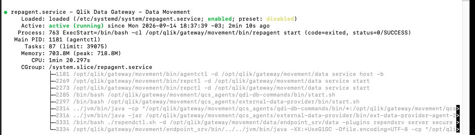
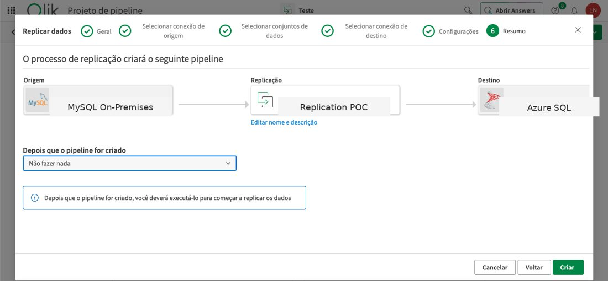
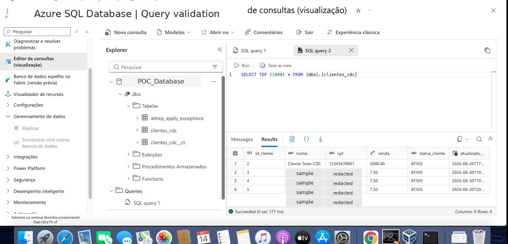
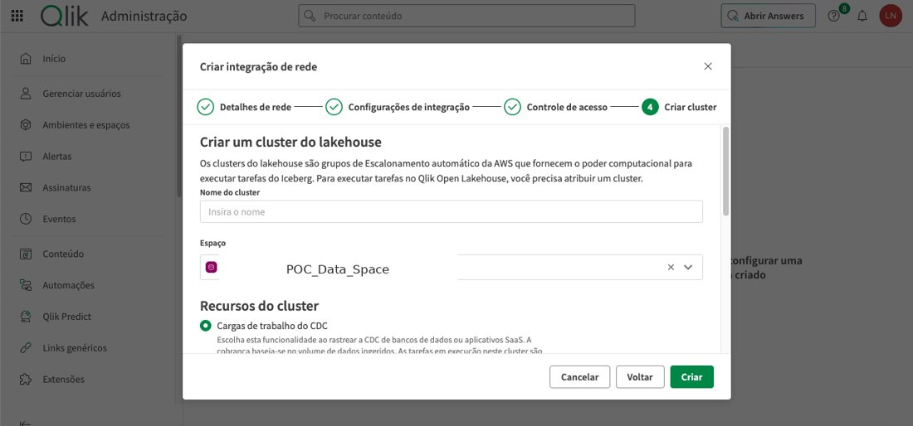
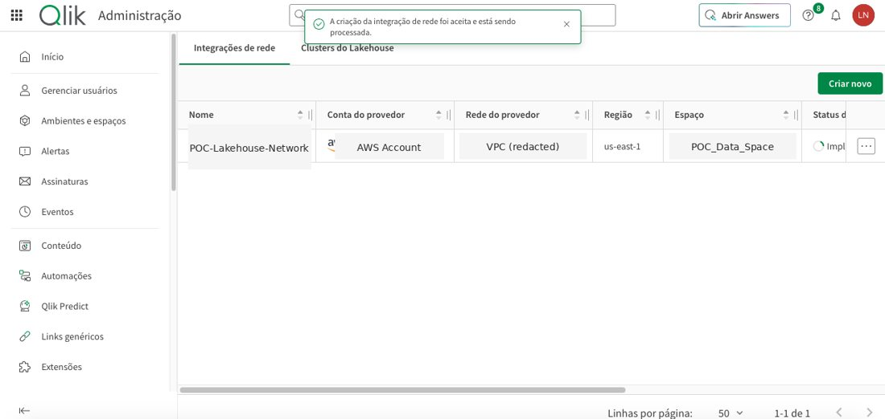

# Evidências técnicas — capturas de tela

Esta página apresenta uma seleção de **capturas de tela tratadas e anonimizadas do projeto real**. O objetivo é fornecer evidências técnicas da implementação, protegendo a infraestrutura interna, informações de contas, dados pessoais e identificadores específicos de clientes.

## 1. Origem de dados MySQL local


Esta captura documenta o **banco de dados MySQL utilizado como origem operacional** da POC.

A origem permanece em ambiente local enquanto o Qlik Data Gateway e o Qlik Talend Cloud fornecem a camada de integração utilizada para movimentar e replicar os dados para o ambiente de destino.

## 2. Qlik Data Gateway em execução



O serviço Linux do **Qlik Data Gateway – Data Movement** está ativo e em execução no ambiente de integração. Esta é uma evidência da camada de gateway e infraestrutura utilizada para viabilizar o cenário de movimentação de dados a partir do ambiente local.

## 3. Fluxo de replicação MySQL local → Azure SQL



O fluxo de replicação no Qlik representa a arquitetura validada da Etapa 1:

```text
MySQL local → Qlik Data Gateway → Qlik Talend Cloud / Data Movement → Azure SQL Database
```

O desenho da replicação inclui **CDC (Change Data Capture, ou Captura de Dados Alterados)** para que as mudanças posteriores na origem sejam propagadas incrementalmente após a carga inicial.

Os nomes internos de conexões e projetos foram substituídos por identificadores genéricos para o portfólio.

## 4. Validação do destino Azure SQL



Esta captura mostra o banco de dados de destino após a replicação, incluindo uma consulta executada com sucesso sobre os registros transferidos. Identificadores pessoais e de teste foram removidos da versão pública preparada.

Juntamente com o fluxo de replicação acima, esta evidência demonstra que os dados chegaram ao destino Azure SQL e puderam ser consultados com sucesso.

## 5. Exploração do Qlik Open Lakehouse / Apache Iceberg



Esta captura documenta a exploração da arquitetura **AWS + Apache Iceberg** utilizando Qlik Open Lakehouse e uma **carga de trabalho de CDC**.

Esse caminho foi explorado e configurado durante a POC, mas **não foi finalizado**, principalmente porque a continuidade da infraestrutura AWS acrescentaria custos desnecessários à prova de conceito.

## 6. Integração de rede AWS aceita no Qlik



Esta captura mostra que a configuração de integração de rede da AWS foi aceita no Qlik durante a exploração do Open Lakehouse.

Números de contas AWS, identificadores de VPC, nomes internos de espaços de dados e identificadores específicos do projeto foram generalizados na versão pública preparada.

## Evidências e escopo do CDC

O CDC faz parte da arquitetura de replicação utilizada na POC. Seu objetivo é capturar as alterações que ocorrem após a carga inicial e propagá-las incrementalmente pelo fluxo de movimentação de dados.

O repositório documenta o CDC como um **recurso técnico validado na POC**, sem afirmar a existência de SLA de latência de produção ou desempenho estritamente em tempo real.

## O que estas capturas de tela comprovam

O conjunto de evidências dá suporte aos seguintes marcos do projeto:

- O MySQL local foi utilizado como origem operacional dos dados.
- O Qlik Data Gateway foi configurado e estava em execução no ambiente de integração.
- O Qlik Talend Cloud / Data Movement foi configurado para replicação.
- O CDC / replicação incremental de alterações fez parte da arquitetura de movimentação de dados.
- O Azure SQL Database foi utilizado como destino validado da Etapa 1.
- Os dados replicados foram validados com sucesso no Azure SQL Database.
- A integração de rede AWS e o Qlik Open Lakehouse / Apache Iceberg foram efetivamente explorados como uma arquitetura alternativa.

## Capturas de tela intencionalmente excluídas

Algumas capturas de tela da implementação real foram intencionalmente deixadas de fora da publicação por exporem detalhes excessivos de infraestrutura sem agregar valor proporcional ao portfólio. Exemplos: páginas brutas de VPC e sub-redes da AWS, identificadores de chaves KMS e ARNs, detalhes de contas e funções IAM, telas de recursos Azure contendo endereços IP ou informações de administradores, além de capturas com nomes internos de servidores ou dados pessoais/de teste.

## Etapa atual com SQL Server

A próxima etapa da arquitetura utilizará o **Microsoft SQL Server como destino de testes de menor custo para o desenvolvimento de pipelines e a continuidade dos testes de CDC**. As evidências dessa etapa só serão adicionadas depois que o destino SQL Server e o fluxo de pipelines estiverem efetivamente configurados e validados tecnicamente.

## Política de anonimização

As capturas de tela públicas não devem expor senhas, chaves de API, tokens, certificados, endereços IP da infraestrutura do projeto, números de contas AWS, IDs de VPC/sub-redes, ARNs, identificadores KMS, nomes internos de servidores/bancos de dados, endereços de e-mail, identificadores de tenant, CPF ou informações confidenciais de clientes e negócios.
